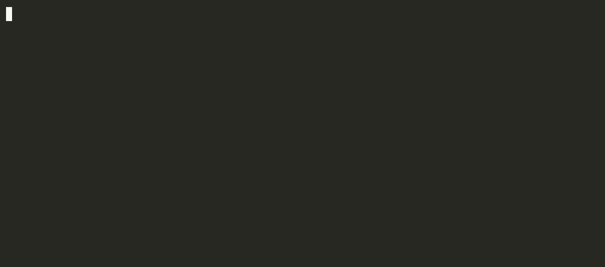

# Tidegate

<p align="center"></p>

**A worse agent can't go live.** Every deploy replays recent real inputs on the new version and the
live one, and the new version goes live only if it does no worse. Like a tidegate in a sea wall,
changes flow one way.

Around that gate, Tidegate hosts the agents: push a folder of agent code in any language and each agent
gets an endpoint, a schedule, secrets and saved files. Every run is recorded with every model call it
made, with no SDK or tracing code. Only the runs that look risky wait for a person, and a person's fix
becomes an example the agent sees next time.

## Try it in two minutes
You need Node 20 or later and Python 3. No account, no API key.

```sh
npm install -g tidegate
git clone https://github.com/akshit9162/tidegate && cd tidegate/examples/support-reply
tidegate dev                   # all of Tidegate on this machine; leave it running
```
In a second terminal, in the same folder:
```sh
tidegate deploy                # live at http://localhost:8787/p/support-reply
tidegate invoke reply '{"email": "Where is my order?"}'
tidegate invoke reply '{"email": "My parcel is late"}'
```

### Watch the gate block a worse agent
Change the reply so it makes a promise the agent's `no_promises` eval forbids, and deploy it:
```sh
sed -i.bak 's/get back to you shortly/guarantee a fix by tomorrow/' reply.py
tidegate deploy                # Blocked: worse than the live version on 2 real inputs. The live version stays.
mv reply.py.bak reply.py
tidegate deploy                # Gate passed: the original goes live again
```
The gate reran the real emails you sent on both versions and compared them. Without an API key the
example answers from a template; set one with `tidegate secret set ANTHROPIC_API_KEY` to use a model.

## The loop
| Step | What Tidegate does |
|---|---|
| Deploy | `tidegate deploy` or `git push tidegate main`. Python, Node, or a Dockerfile; versions kept, rollback is one command. |
| Record | Input, output, log and files of every run, and every model call it made (model, tokens, time). |
| Review | With `"review": {"when": "flagged"}`, only runs with low confidence, a failed eval, a failed judge question or errors wait for you. Approve, edit the output, revise with a note, or reject. |
| Learn | Outputs you approved or corrected reach later runs in `$TIDEGATE_EXAMPLES`. |
| Judge | A decision model (TypeSafe Jev, Google Gemini Decision, or an open-weight model) answers typed questions about every run. |
| Prove | With `"gate"`, each deploy replays recent real inputs on the new and the live version, and goes live only if it does no worse. |

## Why not a hosting provider plus a tracing tool plus an eval tool
Most teams running agents glue together a host (Render, Modal, AWS), a tracing tool (LangSmith,
Langfuse) that needs code in the agent, and an eval tool, then compare versions by hand. Tidegate is one
place for all three, with no instrumentation code, and its review decisions are the labels its evals
and judge are measured against.

## Writing an agent
- Read the input from the JSON file at `$TIDEGATE_INPUT` and write the output as JSON to `$TIDEGATE_OUTPUT`.
  Print logs to stdout. That is the whole contract, so any language and any framework works.
- Call your model as usual. `ANTHROPIC_BASE_URL` and `OPENAI_BASE_URL` point at Tidegate, which records
  each call and passes it on with your own key.
- Report how sure you are and how you did: `{"confidence": 0.8, "evals": {"cites_source": true}}`.
- `$TIDEGATE_EXAMPLES` holds reviewed outputs: `good` (approved or corrected) and `avoid` (rejected, with
  the reviewer's note). Use them as few-shot examples.
- Files in tidegate.json `state` are kept between runs; files written to `$TIDEGATE_FILES` are kept with the
  run and shown in review; listed secrets arrive as environment variables.
- `"review": {"then": "send", "when": "flagged"}` holds risky runs for a person and runs `send` with the
  approved output. Replays never trigger `send`; an agent that acts itself should check
  `TIDEGATE_TRIGGER=replay`.

`examples/support-reply` uses all of this; `examples/ticket-triage` shows state and schedules. The full
design, including the judge and the gate, is in [SPEC.md](SPEC.md).

## Commands
Install with `npm install -g tidegate`. Outside a clone of this repo, `npx tidegate` works without installing.
```sh
tidegate deploy [--no-promote] [--replay AGENT]   # upload; live when checks (and the gate) pass
tidegate invoke AGENT [JSON]                       # run an agent and print its output
tidegate reviews | approve | correct | revise | reject RUN
tidegate runs | trace RUN | scorecard [AGENT] | logs RUN
tidegate promote VERSION | rollback [VERSION]
tidegate secret set NAME
tidegate dashboard                                 # the runs page, signed in
tidegate runner [--isolate docker]                 # run agents, each in a container with docker
tidegate mcp                                       # deploy, invoke, status and runs as MCP tools
```
`git remote add tidegate tidegate::<project>` then `git push tidegate main` deploys the pushed commit
(with `git-remote-tidegate` on your PATH, for example through `npm link`).

## Run it from source
```sh
npm install
npm link                     # puts tidegate and git-remote-tidegate on your PATH
tidegate dev                   # Worker, local database and a runner; data in ~/.tidegate/dev
```
Tidegate is a Cloudflare Worker (D1 and R2) plus a runner you can run anywhere, including inside your
own infrastructure, so agent code and secrets can stay on your machines.

## Run it on your own Cloudflare account
```sh
npx wrangler d1 create tidegate          # put the printed database_id in wrangler.toml
npx wrangler r2 bucket create tidegate-files
npm run db:remote                        # create the tables
openssl rand -base64 32 | npx wrangler secret put SECRETS_KEY
openssl rand -hex 24 | tee /dev/tty | npx wrangler secret put RUNNER_TOKEN
npx wrangler deploy
```
Set `DOMAIN` and `SCHEME` in wrangler.toml to your Worker's address. Then run a runner anywhere,
with the same token: `RUNNER_TOKEN=... TIDEGATE_API=https://your-worker tidegate runner --isolate docker`.

## Tests
```sh
npm test                     # unit tests

# end to end, once: local secrets and tables
printf 'SECRETS_KEY=%s\nRUNNER_TOKEN=%s\n' "$(openssl rand -base64 32)" "$(openssl rand -hex 24)" > .dev.vars
npm run db
npm run dev:e2e              # a Worker pointed at the test's mock model API
set -a; . ./.dev.vars; set +a; tidegate runner   # second terminal (E2E_ISOLATE=docker with --isolate docker)
node test/e2e.mjs            # third terminal
```
